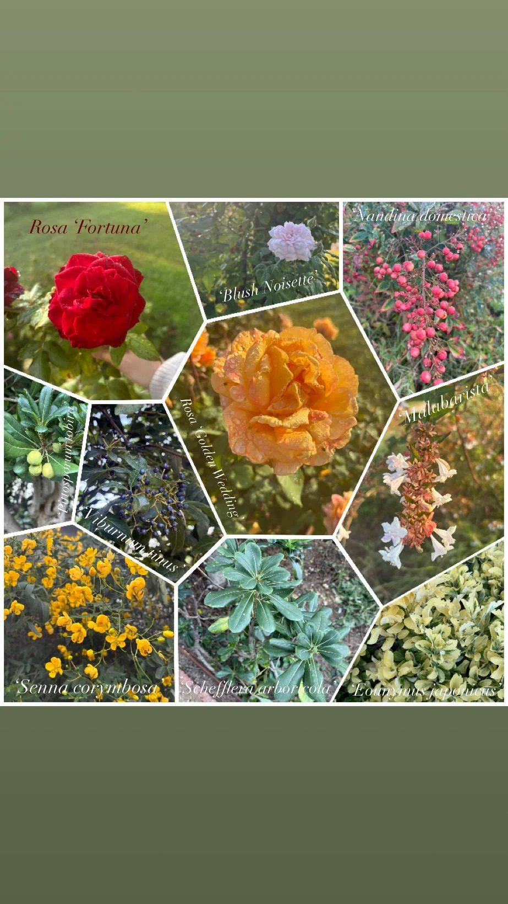

# Espècies vegetals — diàleg amb el jardí

> Noms i observacions transcrits de les pàgines 24–26 del PDF, no verificats taxonòmicament.
> **Important:** hi ha grafies dels noms botànics que podrien ser errònies. No corregir-les sense validació d’Ariadna.
> Les fotografies soltes del ZIP no porten una assignació fiable a cada espècie. Associar-les visualment només quan Ariadna ho confirmi.

## 01. Rosa ‘Fortuna’

**Text del document:**

Aquesta rosa m'ha cridat especialment l'atenció pel seu color
vermell intens i la seva forma, que destaca entre la resta d'elements de la planta.
També m'ha agradat molt la seva fragància dolça i agradable. A més, m'he fixat en
el contrast de textures entre la tija, més rugosa i resistent, i els pètals, molt més
delicats i suaus. Considero que és una flor que destaca especialment per la força
del seu color i la seva presència visual.

## 02. Blush Noisette

**Text del document:**

Aquesta flor m'ha captivat per la seva forma i la disposició dels
pètals, que li donen un aspecte molt particular. També m'ha cridat l'atenció la
combinació de colors i la delicadesa de la flor en contrast amb la resistència de la
tija. Pel que fa a l'olfacte, presenta una fragància suau però agradable. És una
d'aquelles flors que conviden a aturar-se i observar-ne els petits detalls.

## 03. Nandina domestica

**Text del document:**

El que més ha despertat el meu interès d'aquesta planta ha
estat la disposició dels seus fruits i el seu color vermell intens, que contrasta amb
les tonalitats verdes de les fulles. També m'he fixat en la seva forma i en la sensació
de duresa i resistència que transmeten els fruits quan els toques. En canvi, pel que
fa a l'olfacte, no he percebut cap aroma que em cridés especialment l'atenció.

## 04. Pittosporum lobiru

**Text del document:**

Aquesta planta m'ha cridat l'atenció principalment pels seus
petits fruits de tonalitats verdoses i per la forma allargada de les seves fulles. En
observar-la més de prop, també m'he fixat en la textura de les fulles, que presenten
una superfície una mica rugosa. M'ha semblat interessant la manera com es
distribueixen els diferents elements de la planta i com les fulles creen una
composició visual força particular.

## 05. Viburnum tinus

**Text del document:**

D'aquesta planta m'han cridat especialment l'atenció els seus
fruits, pel color intens i la manera com es distribueixen entre les branques. També
m'he fixat en les seves fulles allargades i en la seva textura. En comparar-les amb
les de la planta anterior, he pogut observar que són menys resistents i més
delicades al tacte. Aquesta comparació m'ha permès adonar-me de les diferències
que poden existir entre espècies vegetals que, a primera vista, poden semblar força
semblants.

## 06. Rosa ‘Golden Wedding’

**Text del document:**

Si hagués d'escollir la meva espècie vegetal preferida,
sens dubte seria aquesta rosa. El seu color ataronjat em desperta emocions
profundes i intenses, ja que em connecta amb records i sentiments de nostàlgia
relacionats amb la meva infància. Per aquest motiu, és una de les plantes que més
m'ha interpel·lat personalment durant el recorregut. També m'ha cridat l'atenció la
seva forma, que em recorda la de la Rosa ‘Fortuna’, tot i que el contrast entre els
colors de totes dues fa que transmetin sensacions molt diferents.

## 07. ‘Abelia x grandiflora

**Text del document:**

M'ha cridat especialment l'atenció la manera com es
distribueixen les flors al llarg de les branques, creant una composició natural molt
atractiva. També m'ha agradat el contrast entre el blanc de les flors i les petites
estructures de tonalitats rosades que les acompanyen. Considero que aquesta
combinació de colors, juntament amb les diferents formes i textures, fa que sigui
una planta visualment molt interessant.

## 08. ’Senna Corymbosa’

**Text del document:**

D'aquesta planta m'ha sorprès especialment el color groc
intens de les flors i la seva forma, que destaca fàcilment entre la resta de vegetació.
També he pogut observar que la tija és força fràgil i poc resistent, ja que es trenca
amb molta facilitat. En canvi, les fulles són allargades i dures al tacte. M'ha semblat
interessant descobrir com una mateixa planta pot presentar parts amb
característiques i textures tan diferents.

## 09. Schefflera arboricola

**Text del document:**

Aquesta planta m'ha cridat l'atenció pel color verd intens de
les seves fulles i per la seva resistència al tacte. Tot i això, el que més m'ha agradat
és la seva disposició, ja que les fulles surten d'un mateix punt i s'obren cap a
diferents direccions, creant una forma que em recorda una flor. Aquesta estructura
em sembla especialment bonica i interessant des d'un punt de vista visual.

## 10. Eounymus japonicus

**Text del document:**

El que més m'ha cridat l'atenció d'aquesta planta és el
contrast entre les diferents tonalitats verdes i groguenques de les seves fulles.
També m'he fixat en la seva disposició, que, igual que en el cas de la Schefflera
arboricola, crea una composició que recorda la forma d'una flor. Pel que fa al tacte,
les fulles presenten una textura suau i són força resistents. M'ha agradat
especialment la combinació de colors, ja que aporta lluminositat a la planta i fa que
destaqui visualment.

---

Total identificat al PDF: **10 espècies**.